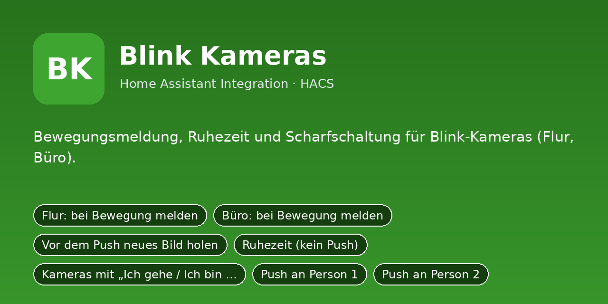
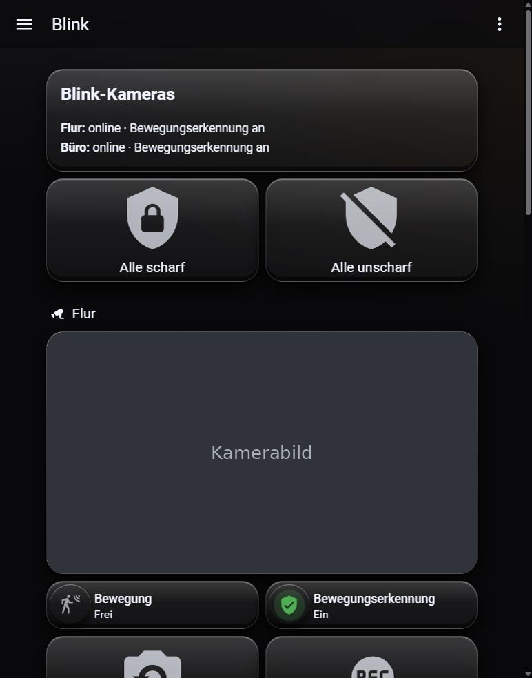

# Blink Kameras

Bewegungsmeldung, Ruhezeit und Scharfschaltung für Blink-Kameras (Flur, Büro).

Python-Integration für Home Assistant (HACS). Sie ersetzt das bisherige YAML-Paket
`blink/packages/blink_kameras.yaml`: Einstellungen sind jetzt eigene Entitäten (Schalter, Zahlen, Auswahlfelder,
Uhrzeiten), die Logik läuft in Python statt in Automationen und Skripten.

## Installation

1. HACS → Integrationen → ⋮ → **Benutzerdefinierte Repositories** →
   `https://github.com/DerGnom1977/ha-blink-kameras` als Kategorie **Integration** hinzufügen.
2. **Blink Kameras** installieren und Home Assistant neu starten.
3. Einstellungen → Geräte & Dienste → **Integration hinzufügen** → *Blink Kameras*.
4. Das Dashboard aus `dashboards/blink_kameras_dashboard.yaml` anlegen (Raw-Konfigurationseditor).

Manuell: Ordner `custom_components/blink_kameras` nach `/config/custom_components/` kopieren.

## Einrichtung

Beim Hinzufügen (und später über „Konfigurieren“) werden diese Angaben abgefragt:

- **Notify-Dienst Person 1** (`notify_person1`), Standard: `mobile_app_mein_handy`
- **Notify-Dienst Person 2** (`notify_person2`), Standard: `mobile_app_partner_handy`
- **Flur: Bewegungssensor** (`flur_motion`), Standard: `binary_sensor.flur_bewegung`
- **Flur: Kamera** (`flur_camera`), Standard: `camera.flur`
- **Flur: Schalter Bewegungserkennung** (`flur_detect`), Standard: `switch.flur_bewegungserkennung`
- **Büro: Bewegungssensor** (`buero_motion`), Standard: `binary_sensor.buero_bewegung`
- **Büro: Kamera** (`buero_camera`), Standard: `camera.buero`
- **Büro: Schalter Bewegungserkennung** (`buero_detect`), Standard: `switch.buero_bewegungserkennung`
- **Anwesenheits-Modus (Integration Anwesenheit)** (`modus_entity`), Standard: `select.anwesenheit_modus`
- **Anwesenheit: Kamera-Push** (`anw_kamera_push`), Standard: `switch.anwesenheit_kamera_push`
- **Anwesenheit: weitere Kameras** (`anw_kamera_weitere`), Standard: `switch.anwesenheit_kamera_weitere`
- **Ordner für gespeicherte Clips** (`clip_dir`), Standard: `/config/www/blink`

## Was du anpassen musst

Alle Standardwerte oben sind **Platzhalter/Beispiele**. Passe sie beim Einrichten an dein System an:

- **Notify-Dienste** (`notify_person1`, `notify_person2`): Name deines Handy-Dienstes ohne `notify.`,
  z. B. `mobile_app_mein_handy` → bei dir `mobile_app_<gerätename>` (Entwicklerwerkzeuge → Aktionen → „notify“).
  „Person 1/Person 2“ sind frei; die Schalter *Push an Person 1/2* schalten die jeweilige Meldung.
- **Entitäten** (`sensor.…`, `camera.…`, `person.…`, `todo.…` usw.): auf die echten Entitäts-IDs aus
  Einstellungen → Geräte & Dienste → Entitäten ändern. Leere Felder sind Pflicht, wenn die Funktion genutzt wird.
- **Dashboard** (`dashboards/blink_kameras_dashboard.yaml`): enthält Entitäts-IDs der Integration; wenn du Namen
  oder Räume änderst, dort per Suchen/Ersetzen nachziehen.
- Später jederzeit unter Einstellungen → Geräte & Dienste → *Blink Kameras* → **Konfigurieren** änderbar.

## Umstieg vom YAML-Paket

1. Das alte Paket `blink/packages/blink_kameras.yaml` (und sein Dashboard) aus `/config/packages/` entfernen
   und Home Assistant neu starten, damit Helfer, Automationen und Skripte nicht doppelt laufen.
2. Integration einrichten. Neue Entitäten haben dieselben Namen wie die alten Helfer, nur mit
   anderer Domain, z. B. `input_boolean.xyz` wird `switch.xyz`, `input_number.xyz` wird `number.xyz`,
   `input_select.xyz` wird `select.xyz`, `input_datetime.xyz` wird `time.xyz`.
3. Eigene Automationen und Dashboards, die alte Entitäten nutzen, entsprechend anpassen.
4. Die alten Standardwerte sind schon eingebaut, die Einstellungen bleiben nach Neustarts erhalten.

## Entitäten

### Schalter

- `switch.blink_push_flur` – Flur: bei Bewegung melden
- `switch.blink_push_buero` – Büro: bei Bewegung melden
- `switch.blink_frisches_bild` – Vor dem Push neues Bild holen
- `switch.blink_ruhezeit_aktiv` – Ruhezeit (kein Push)
- `switch.blink_mit_anwesenheit` – Kameras mit „Ich gehe / Ich bin da“ ein-/ausschalten
- `switch.blink_ziel_person1` – Push an Person 1
- `switch.blink_ziel_person2` – Push an Person 2

### Zahlenwerte

- `number.blink_pause` – Pause zwischen Meldungen

### Auswahlfelder

- `select.blink_aktion_flur` – Flur: bei Bewegung
- `select.blink_aktion_buero` – Büro: bei Bewegung
- `select.blink_wann` – Push senden

### Uhrzeiten

- `time.blink_ruhe_von` – Ruhezeit von
- `time.blink_ruhe_bis` – Ruhezeit bis

### Knöpfe

- `button.blink_standardwerte` – Standardwerte setzen

## Hinweis

Die Integration wurde aus dem bestehenden YAML-Paket portiert und ist noch nicht in einer laufenden
Home-Assistant-Instanz getestet. Bitte beim ersten Einsatz die Logbuch-/Protokoll-Meldungen
(`custom_components.blink_kameras`) im Blick behalten.
